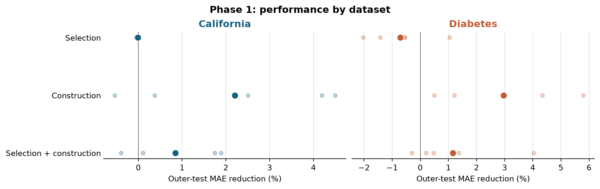
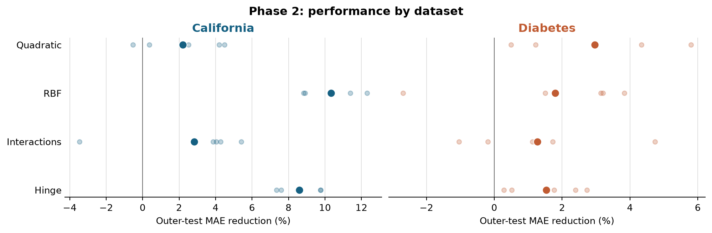
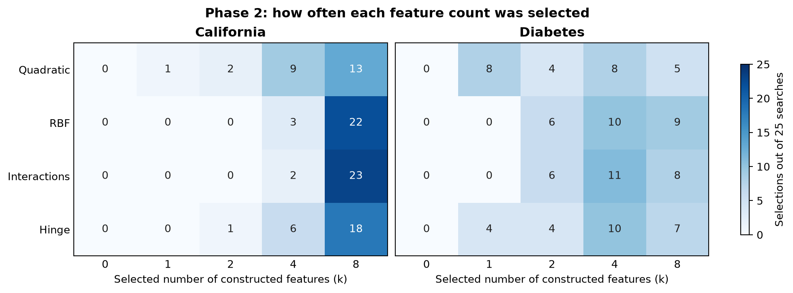
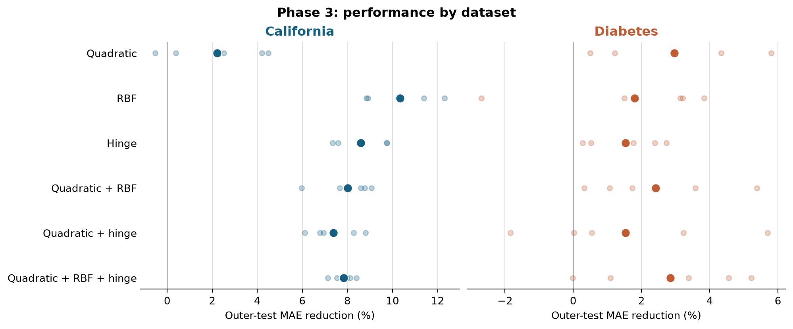
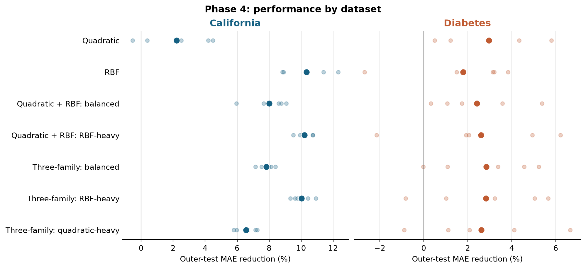
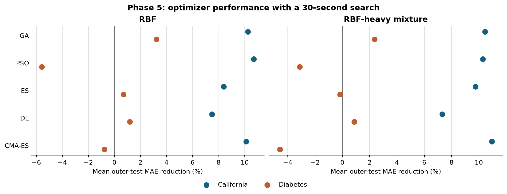
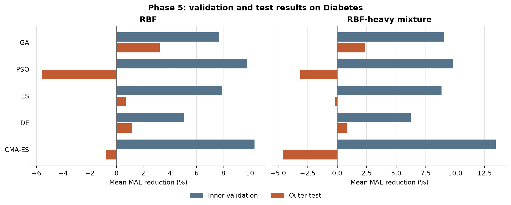
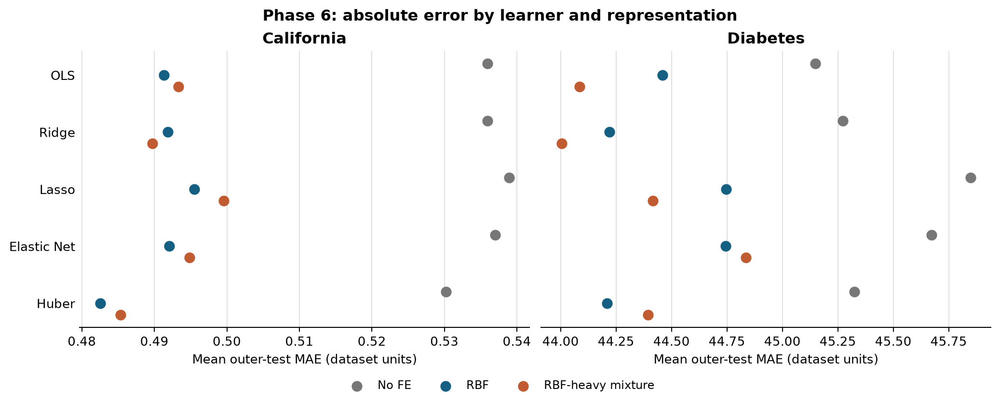
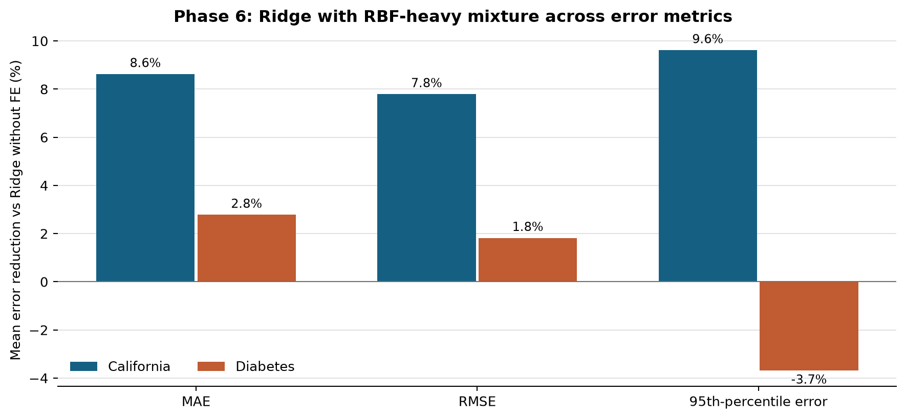
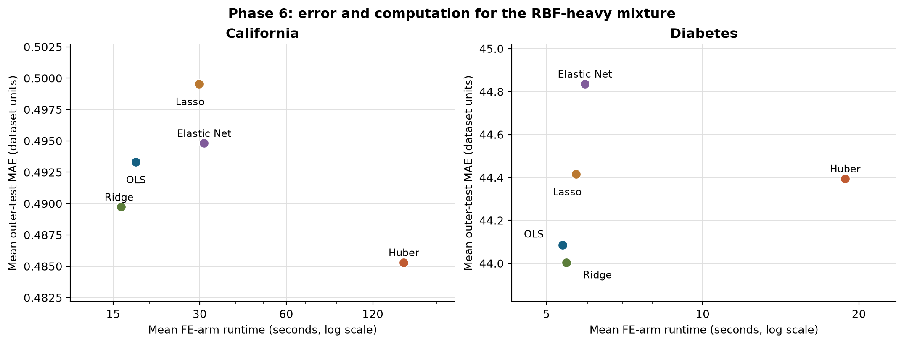

# Bio-inspired feature engineering for regression: project report

## Abstract

This report presents a six-phase study of bio-inspired feature engineering for regression. The objective was to identify a practical procedure that improves predictive performance on both California Housing and Diabetes Progression. The study compared feature-engineering strategies, screened feature families, investigated balanced and asymmetric mixtures, compared optimizers under evaluation and time budgets, and examined the shortlisted procedures across linear learners. All phases use both datasets. The results support construction with GA and suggest Ridge with an RBF-heavy mixture as a promising common pipeline, subject to the exploratory limitations described below.

## Objective and scope

The aim is to identify a feature-engineering procedure that helps a family of regression learners predict unseen observations. The experiment consisted of **six phases**: strategy, individual families, balanced mixtures, asymmetric mixtures, optimizers and linear learners. The initial comparison considered selecting original inputs, constructing additional features, and combining both strategies. In the subsequent phases, original inputs are retained and constructed columns are appended. 

The two datasets are California Housing and Diabetes Progression. Although the strongest individual choices varied by dataset, the aim was to carry forward a **common strategy that helped both datasets simultaneously**. We therefore reviewed each dataset's results together, when choosing a shared procedure. The feature search itself was still performed separately on each dataset; no joint model or pooled objective was optimized across the two datasets. The selected procedure is an exploratory compromise, not proof that it is optimal for each dataset or that it will help every future dataset.

### Experiment design

The sequence progressively narrowed the problem. First, comparing broad strategies established a starting point for how original and constructed features should be used. Next, individual-family screening identified promising mathematical forms. Balanced and then asymmetric mixtures tested whether those forms could complement each other and offer a useful compromise across the two datasets. Once a small representation shortlist was available, the optimizer comparison could hold each feature task fixed; the final phase evaluates the shortlisted feature procedures across different linear learners.

This order made the programme computationally manageable: testing every strategy, family, allocation, optimizer and learner together would have multiplied the number of searches. It also made each comparison easier to interpret by keeping major choices fixed while another factor varied. The sequence has a trade-off: earlier choices can influence later results, so narrowing the study does not prove that combinations excluded earlier would have performed worse. The phases and their decisions should be read as an exploratory research sequence, not as a fully prespecified, independently confirmed search for a global optimum.

We fixed GA ooptimizer and OLS learner from phases 1 through 4. The use of GA was a practical design choice, not a conclusion that GA was already the best optimizer. Keeping OLS fixed made it easier to observe whether the constructed columns helped a simple linear learner capture patterns missing from the original inputs, without changing the downstream learner at the same time. These controls improves interpretability, giving the strategy and representation comparisons a shared search framework and candidate budget.

## Common evaluation procedure

Each study used five shared 80/20 outer development/test splits per dataset. Within each outer-development partition, three inner folds were used to score candidate transformations by mean validation MAE. Imputation, scaling and other preprocessing were fitted using only the applicable inner-training fold. After the inner search selected a candidate and feature count, preprocessing and the learner were refitted on the outer-development data and evaluated on the held-out outer test.

The GA searches the parameters of candidate constructed features. It does not choose the mathematical family from an unrestricted set: the experiment defines the family or allocation, and GA searches its parameters. The learner's own coefficients or tree structure are fitted separately. The number of additional columns, `k`, is chosen from a prespecified grid using inner validation. For construction arms, `k=0` reuses the no-FE inner score and provides an option to construct no features.

The datasets target units differ, so raw MAEs are reported within each dataset and cross-dataset comparisons use percentage reduction relative to the appropriate no-feature-engineering (no-FE) baseline. The primary metric is defined as the percentage reduction in outer-test MAE relative to the **same learner's no-FE baseline on the same split**:

$$
\text{MAE reduction (\%)} = 100 \times
\frac{\text{MAE}_{\text{without FE}} - \text{MAE}_{\text{with FE}}}
{\text{MAE}_{\text{without FE}}}
$$

Positive values indicate lower MAE with feature engineering. Search-seed results are averaged within each outer split, and the five split values are then averaged.

The configurations and source results for the reported experiments are organized by phase:

| Phase | Configurations | Results |
| --- | --- | --- |
| 1 | [Adaptive](../configs/phase_1/adaptive.yaml), [fixed capacity](../configs/phase_1/fixed.yaml) | [Adaptive](../results/phase_1/adaptive/runs.csv), [fixed capacity](../results/phase_1/fixed/runs.csv) |
| 2 | [Individual families](../configs/phase_2/individual.yaml) | [Individual families](../results/phase_2/individual/runs.csv) |
| 3 | [Balanced mixtures](../configs/phase_3/balanced.yaml) | [Balanced mixtures](../results/phase_3/balanced/runs.csv) |
| 4 | [Asymmetric mixtures](../configs/phase_4/asymmetric.yaml) | [Asymmetric mixtures](../results/phase_4/asymmetric/runs.csv) |
| 5 | [Equal candidates](../configs/phase_5/equal_candidates.yaml), [equal time](../configs/phase_5/equal_time_30s.yaml) | [Equal candidates](../results/phase_5/equal_candidates/runs.csv), [equal time](../results/phase_5/equal_time_30s/runs.csv) |
| 6 | [Linear learners](../configs/phase_6/linear_learners.yaml) | [Linear learners](../results/phase_6/linear_learners/runs.csv) |

## Code overview

The project uses a common Python pipeline for all six phases. Each phase configuration in `configs/` specifies the learners, feature-engineering arms, search budgets and seeds; the shared dataset manifest identifies the two local datasets. The corresponding `results/phase_*` folders contain the saved results. Phase 1 and Phase 5 each have two configurations and result directories because they include more than one comparison.

The main components have the following roles:

- [Experiment runner](../src/experiments.py) reads a configuration, coordinates the splits and searches, selects features using inner validation, and evaluates the selected model on the outer test set.
- [Data preparation](../src/data.py) loads the data and fits preprocessing within the appropriate training partition. [Strategies](../src/strategies.py) and [representations](../src/representations.py) define how original and constructed features are presented to a learner.
- [Optimizers](../src/optimizers.py) search for feature parameters under the specified candidate or time budget. [Evaluation](../src/evaluation.py) fits the learners and calculates prediction errors.
- [Reporting](../src/reporting.py) summarizes saved runs, while [replay](../src/replay.py) can reconstruct an individual saved pipeline and check its recorded hashes and MAE.

Each result directory contains `runs.csv` for per-run metrics, `definitions.jsonl` for selected features and search details, `splits.json` for the data partitions, and `convergence.csv` for search progress. `protocol.json` records the configuration and software versions; later runs also record environment details and retain checkpoints for resuming interrupted work. Exact replay hashes can depend on the numerical environment; checked Phase 1 runs reproduced their saved MAE to floating-point precision but did not reproduce every hash.

The figures below are generated from the saved run tables by [plot_report.py](../scripts/plot_report.py). Run `python scripts/plot_report.py` from the project root to regenerate them in `docs/figures/`.

## Phase 1: choosing the feature-engineering strategy

### Motivation and controlled settings

The first question was whether prediction improves most by selecting existing features, constructing new features, or combining the two. The experiment compared each strategy against OLS fitted on the original features:

| Arm | Inputs presented to the learner |
| --- | --- |
| No FE | All original features |
| Selection | A searched subset of original features |
| Construction | All original features plus searched quadratic projections |
| Selection + construction | A searched subset of direct original inputs plus quadratic projections |

For the three searched strategies, the learner was OLS, the optimizer was GA, and constructed features were quadratic projections `(wᵀx)²`. The datasets, five outer splits, three inner folds, five search seeds and total allowance of 1,000 candidate evaluations per searched arm were shared. Construction and combined arms used `k ∈ {0,1,2,4,8}`, selected using inner validation. In construction-only, `k=0` reuses the no-FE validation score and the budget is divided across positive counts. In the combined arm, `k=0` still searches a selection mask and consumes part of its budget. Selection-only searches a mask without constructed columns.

The combined arm may use an original input inside a constructed projection even if its mask removes that input as a direct learner column. Thus its selection mask controls direct retention; it does not necessarily remove a variable from the entire transformation. The strategies also have different search spaces, so the contrast is between complete search procedures under the stated budget.

### Findings

| Dataset | Strategy | Mean outer-test MAE | Mean MAE reduction | Positive split means |
| --- | --- | ---: | ---: | ---: |
| California | No FE | 0.5359 | — | — |
| California | Selection | 0.5360 | −0.01% | 3/5 |
| California | Construction | 0.5241 | **2.21%** | 4/5 |
| California | Selection + construction | 0.5314 | 0.85% | 4/5 |
| Diabetes | No FE | 45.1491 | — | — |
| Diabetes | Selection | 45.4591 | −0.71% | 1/5 |
| Diabetes | Construction | 43.7882 | **2.96%** | 5/5 |
| Diabetes | Selection + construction | 44.6023 | 1.15% | 4/5 |

*Phase 1. Small points show the five outer-split means after averaging search seeds; large points show their average. Zero represents the no-FE baseline. The two panels have separate horizontal scales.*

Construction produced the largest mean MAE reduction on both datasets. A supplementary fixed-`k` comparison at `k=1,2,4` also favored construction over selection + construction at each count on average. Those fixed-count runs spent all 1,000 evaluations at one `k`, while adaptive runs divided their budget across counts; fixed-versus-adaptive differences therefore combine capacity and search-effort effects.

The preferred capacity varied. Adaptive construction selected `k=8` in 13 of 25 California searches, while Diabetes selected `k=1,2,4,8` in 8, 4, 8 and 5 searches respectively. Selecting the edge of the grid does not show that larger values would generalize better. On California, quadratic construction reduced mean MAE but increased mean RMSE from 0.7455 to 0.9032, highlighting the importance of residual tails.

**Decision carried forward:** retain all original features and focus subsequent phases on construction, while allowing `k` to be selected per dataset and learner. This choice is supported for the tested OLS/GA/quadratic setting and budget; it is not proof that construction always beats selection for other representations or learners.

## Phase 2: individual feature-family screening

### Motivation and controlled settings

Different mathematical constructions may capture different patterns. The second phase compared four families before deciding which combinations were worth exploring:

- **Quadratic projections:** squared linear projections, `(wᵀx)²`, representing global nonlinear combinations of inputs.
- **RBF features:** localized responses based on distance from a learned center.
- **Explicit interactions:** products of selected pairs of input variables.
- **Hinge projections:** piecewise-linear features `max(0, wᵀx − t)`.

All arms retained the original inputs, used OLS and GA, shared the folds and seeds, and had 1,000 candidate evaluations per arm. Each searched `k ∈ {0,1,2,4,8}`; 250 evaluations were allocated to each positive count. Five search seeds were used per outer split. The complete screen used 200,000 candidate evaluations.

### Findings

| Family | California mean MAE reduction | Diabetes mean MAE reduction | Equal-dataset mean |
| --- | ---: | ---: | ---: |
| Quadratic | 2.21% | **2.96%** | 2.58% |
| RBF | **10.34%** | 1.80% | 6.07% |
| Interactions | 2.82% | 1.27% | 2.04% |
| Hinge | 8.59% | 1.54% | 5.06% |

*Phase 2. Large points are mean MAE reductions; small points are the five split means. Horizontal scales differ between datasets.*

*Phase 2 capacity choices. Each row shows how often inner validation selected each number of additional features across 25 searches: five search seeds on each of five splits. The seeds within a split share data and are not independent test splits. For example, California selected eight RBF features in 22 of 25 searches, while Diabetes selected a wider range of counts. Selecting the maximum tested count does not establish that a larger count would perform better.*

RBF was strongest on California, while quadratic was strongest on Diabetes. Hinge was also promising on California. California quadratic and interaction features lowered MAE but increased mean RMSE, indicating that occasional large errors can offset improvements in typical error. This motivated retaining tail metrics alongside MAE.

**Decision carried forward:** investigate combinations involving quadratic, RBF and hinge. The results did not establish that a single family is universally best. The quadratic, RBF and interaction arms repeated earlier configurations and are not independent replications.

## Phase 3: balanced family mixtures

### Motivation and controlled settings

Because different families led on the two datasets, the next question was whether combining their complementary forms could yield a better compromise. OLS, GA, datasets, splits, folds and the 1,000-candidate total budget remained fixed. The study compared pure quadratic, RBF and hinge arms with quadratic + RBF, quadratic + hinge, and quadratic + RBF + hinge mixtures. It used five search seeds per split and 300,000 candidate evaluations in total.

Mixture proportions were balanced and their parameters optimized jointly. Two-family mixtures searched total `k ∈ {0,2,4,8}`; the three-family mixture searched `k ∈ {0,3,6}`. Pure families searched `k ∈ {0,1,2,4,8}`. Every arm had the same total budget, but because the grids contain different numbers of positive counts, they received different search effort per count. This is a comparison of complete adaptive pipelines, not a pure fixed-capacity comparison.

### Findings

| OLS construction arm | California MAE reduction | Diabetes MAE reduction | Equal-dataset mean |
| --- | ---: | ---: | ---: |
| RBF | **10.34%** | 1.80% | **6.07%** |
| Quadratic | 2.21% | **2.96%** | 2.58% |
| Quadratic + RBF | 8.01% | 2.41% | 5.21% |
| Quadratic + hinge | 7.38% | 1.53% | 4.45% |
| Quadratic + RBF + hinge | 7.83% | 2.85% | 5.34% |

*Phase 3. The figure includes all six tested arms, including the pure hinge control. Large points are means and small points are split means; horizontal scales differ between datasets.*

No balanced mixture exceeded the best pure family on either dataset's mean MAE reduction. The three-family mixture nevertheless produced a compromise: its Diabetes gain was close to quadratic's while preserving a substantial California gain. The result suggested examining proportions other than equal shares.

**Decision carried forward:** retain pure-family controls and test a small, prespecified set of asymmetric allocations. Interactions were not prioritized for the mixture comparison because their standalone performance was weaker and their California tail errors were severe; this does not prove that interaction mixtures cannot help.

## Phase 4: asymmetric mixtures

### Motivation and controlled settings

A balanced mixture might give too little capacity to the family most useful on a dataset. The asymmetric study therefore compared pure quadratic and RBF controls, balanced quadratic + RBF and balanced three-family controls, an RBF-heavy quadratic + RBF mixture, and RBF-heavy and quadratic-heavy three-family mixtures. OLS, GA, both datasets, five outer splits, five search seeds and 1,000 total candidates per arm remained fixed. The study completed 350,000 candidate evaluations.

Three-family allocations are ordered **quadratic, RBF, hinge**. The balanced arm searched `(1,1,1)` and `(2,2,2)`; the RBF-heavy arm searched `(1,2,1)` and `(1,4,1)`; the quadratic-heavy arm searched `(2,1,1)` and `(4,1,1)`. Each arm also had the no-FE option, and inner validation selected its allocation. Different arms used different grids, so equal total budgets did not isolate allocation proportions at every capacity.

### Findings

| OLS construction arm | California MAE reduction | Diabetes MAE reduction | Equal-dataset mean |
| --- | ---: | ---: | ---: |
| Quadratic | 2.21% | **2.96%** | 2.58% |
| RBF | **10.34%** | 1.80% | 6.07% |
| Quadratic + RBF, balanced | 8.01% | 2.41% | 5.21% |
| Quadratic + RBF, RBF-heavy | 10.21% | 2.60% | 6.41% |
| Three-family, balanced | 7.83% | 2.85% | 5.34% |
| Three-family, RBF-heavy | 10.01% | 2.83% | **6.42%** |
| Three-family, quadratic-heavy | 6.56% | 2.61% | 4.59% |

*Phase 4. Large points show mean MAE reduction and small points show the five split means. The separate horizontal scales make within-dataset differences easier to see.*

The RBF-heavy three-family arm retained most of pure RBF's California improvement while approaching quadratic's Diabetes improvement. Its equal-dataset mean exceeded pure RBF's, but was only 0.013 percentage points above the RBF-heavy two-family arm. That difference is descriptive and does not establish a reliable ranking. Pure RBF remained strongest on California and quadratic remained strongest on Diabetes.

**Decision carried forward:** use the RBF-heavy three-family mixture as a candidate common procedure and pure RBF as a simpler reference for optimizer comparison. Although the leading family differed by dataset, the mixture was chosen as a compromise because it helped both simultaneously and had a strong equal-dataset mean. This was a manual shortlist based on both datasets, not an automatic winner selection or a joint optimization over pooled data.

## Phase 5: optimizer comparison

### Comparison with equal candidate evaluations

#### Motivation and controlled settings

Phases 1–4 used GA. This phase asked whether other search methods could improve the shortlisted tasks or provide a better compute trade-off. It compared GA, particle swarm optimization (PSO), evolution strategy (ES), differential evolution (DE), and covariance matrix adaptation evolution strategy (CMA-ES) on both datasets.

The learner remained OLS. Within each of the two tasks—pure RBF and the RBF-heavy mixture—every optimizer used the same folds, bounds, seed schedule, capacity grid and 1,000-candidate total budget. RBF allocated 250 evaluations to each of `k=1,2,4,8`; the mixture allocated 500 to each of `k=4,6`. Both included no FE. The two tasks used different parameter spaces and grids, so optimizer effects should first be compared **within** a task. The study completed 500,000 candidate evaluations.

#### Findings

| Task | Optimizer | California MAE reduction | Diabetes MAE reduction | Equal-dataset mean |
| --- | --- | ---: | ---: | ---: |
| RBF | GA | 10.34% | **1.80%** | 6.07% |
| RBF | PSO | 10.24% | −0.17% | 5.03% |
| RBF | ES | 8.95% | 1.43% | 5.19% |
| RBF | DE | 7.69% | 1.58% | 4.64% |
| RBF | CMA-ES | **10.61%** | 1.70% | **6.16%** |
| RBF-heavy mixture | GA | 10.01% | **2.83%** | **6.42%** |
| RBF-heavy mixture | PSO | 10.01% | 0.55% | 5.28% |
| RBF-heavy mixture | ES | 9.22% | 1.93% | 5.57% |
| RBF-heavy mixture | DE | 6.89% | 0.76% | 3.82% |
| RBF-heavy mixture | CMA-ES | **10.41%** | 0.86% | 5.63% |

CMA-ES had the largest California mean gain for both tasks, while GA had the largest Diabetes mean gain. For the mixture, GA's stronger Diabetes result made it the practical common choice for the next phase. At the fixed evaluation budget, mean mixture-run wall times were similar across optimizers: approximately 24–25 seconds on California and about 5 seconds on Diabetes. Timed convergence traces describe inner-validation search; they do not constitute a strict equal-time comparison or an outer-test learning curve.

On Diabetes with the mixture, CMA-ES and PSO obtained better median final inner-validation reductions than GA but worse mean outer-test reductions. These summaries use different averaging and do not establish a cause, yet they show that a better search score did not reliably translate into better held-out performance in this study. Optimizer settings were fixed rather than independently tuned, and representation selection in earlier phases was conditional on GA.

The optimizer comparison has an important selection limitation: the two tasks were shortlisted after GA-based exploration, so their selection may favor representations that GA searches well. The controlled comparison asks how the tested optimizers perform **on those shortlisted tasks**, not which optimizer would be best across every strategy or whether another optimizer would have preferred a representation excluded in phases 1–4. Equal candidate budgets also do not ensure equal search difficulty or optimal settings for each method. Moreover, the same datasets and overlapping outer splits contributed to the shortlist, making the optimizer results exploratory rather than independent confirmation.

### Comparison with equal search time

#### Motivation and controlled settings

The same five optimizers were also compared using a nominal **30-second feature-search allowance per run** on both datasets and both feature tasks. The allowance was divided equally among the positive feature counts: 7.5 seconds per count for RBF and 15 seconds per count for the mixture. A candidate already being evaluated could finish after its deadline. Unlike the equal-evaluation comparison, candidate counts could differ between optimizers and datasets.

#### Findings

| Task | Optimizer | California MAE reduction | Diabetes MAE reduction | Equal-dataset mean |
| --- | --- | ---: | ---: | ---: |
| RBF | GA | 10.25% | **3.23%** | **6.74%** |
| RBF | PSO | **10.69%** | −5.58% | 2.56% |
| RBF | ES | 8.39% | 0.69% | 4.54% |
| RBF | DE | 7.48% | 1.17% | 4.33% |
| RBF | CMA-ES | 10.12% | −0.78% | 4.67% |
| RBF-heavy mixture | GA | 10.44% | **2.35%** | **6.40%** |
| RBF-heavy mixture | PSO | 10.29% | −3.13% | 3.58% |
| RBF-heavy mixture | ES | 9.74% | −0.17% | 4.79% |
| RBF-heavy mixture | DE | 7.31% | 0.86% | 4.08% |
| RBF-heavy mixture | CMA-ES | **10.95%** | −4.58% | 3.19% |

*Phase 5. Points show mean MAE reduction for each optimizer and dataset under the 30-second allowance. Positive values improve on no FE; the two task panels use separate horizontal scales.*

GA had the largest equal-dataset mean for both tasks. On California, PSO achieved the largest mean reduction for RBF and CMA-ES led for the mixture, but both had negative mean reductions on Diabetes. GA improved Diabetes on four of five split means for each task. In the Diabetes mixture task, CMA-ES achieved a mean inner-validation reduction of 13.44%, compared with GA's 9.07%, yet its outer-test reduction was lower. This illustrates that better inner-validation performance did not necessarily generalize to the outer test; the gap is descriptive and does not establish its cause.

*Phase 5 validation and test comparison on Diabetes. The inner-validation bars summarize the score used to select features; outer-test bars summarize held-out results. Each is a percentage reduction against its corresponding no-FE baseline, with seeds averaged within split. The two scores use different observations, so their gap is descriptive rather than proof of a particular cause.*

Errors beyond MAE reinforce the trade-off: for the 30-second Diabetes mixture task, mean RMSE was 55.22 for GA and 66.43 for CMA-ES, compared with 55.59 without FE. The 30-second experiment completed 2,115,886 candidates across 500 searched runs, with a mean search time of 30.04 seconds and approximately 5 hours 19 minutes of recorded active time including work outside the search allowances. Results remain conditional on the time allocations, optimizer settings, OLS and previously examined datasets. See the [equal-time protocol](phase5_equal_time_30s.md).

**Decision carried forward:** use GA for the shortlisted mixture and pure RBF in the learner comparison. The equal-candidate comparison informed this choice; the 30-second results were obtained after the learner experiment was launched and provide additional evidence. This is a task- and budget-specific working choice, not a claim that GA is universally best.

## Phase 6: learner comparison

### Motivation and controlled settings

The final phase asked whether the shortlisted representations help different linear learners and whether a common learner and feature procedure performs well on both datasets. GA was retained as the working optimizer, and the same five outer splits, three inner folds and five search seeds were used. Each learner was compared with its own no-FE baseline, pure RBF and the RBF-heavy mixture. The feature search was rerun separately for every learner, dataset, split and seed; features were not borrowed from an OLS search.

The panel used fixed, reasonable settings without a separate hyperparameter-tuning phase: OLS with an intercept; Ridge with `alpha=1.0`; Lasso with `alpha=0.01`; Elastic Net with `alpha=0.01` and `l1_ratio=0.5`; and Huber with `epsilon=1.35` and `alpha=0.0001`. Lasso and Elastic Net used `max_iter=10000`, and Huber used `max_iter=1000`. Each learner included an intercept. These settings are not evidence that the learners were compared at their individual optima.

Preprocessing was fitted separately on each inner-training fold. In addition to the original-input preprocessing used in earlier phases, the complete post-construction feature matrix and target were standardized within each training fold; predictions were transformed back to target units. This helps make the fixed regularization settings usable across datasets, but means the learner pipelines are not identical to those in earlier phases. The same procedure was used for each learner's no-FE baseline and refitted on outer-development data before test evaluation.

Each feature arm used 500 candidate evaluations per run. RBF searched `k={0,1,2,4,8}`, allocating 125 evaluations to each positive count; the mixture searched `k={0,4,6}`, allocating 250 to each positive count. Inner MAE selected the count, including no FE. Unlike the earlier computationally heavy learner comparison, this linear-only study used **five search seeds per split**. It completed 250,000 candidate evaluations across 500 searched runs, plus 50 baseline rows. A crash damaged the progress record and an in-progress checkpoint; intact completed checkpoints were reused and the damaged arm was restarted. Prior recorded active time was estimated for recovery; see the [recovery record](../results/phase_6/linear_learners/crash_recovery_20261117/README.md).

### Findings

The table reports mean outer-test MAE; percentages in parentheses are mean reductions against the same learner's no-FE baseline on each split. Search seeds are averaged within split before averaging the five splits.

| Dataset | Learner | No-FE MAE | RBF MAE (reduction) | RBF-heavy mixture MAE (reduction) |
| --- | --- | ---: | ---: | ---: |
| California | OLS | 0.536 | 0.491 (8.32%) | 0.493 (7.96%) |
| California | Ridge | 0.536 | 0.492 (8.22%) | 0.490 (8.63%) |
| California | Lasso | 0.539 | 0.495 (8.06%) | 0.500 (7.31%) |
| California | Elastic Net | 0.537 | 0.492 (8.37%) | 0.495 (7.85%) |
| California | Huber | 0.530 | **0.483 (8.84%)** | 0.485 (8.32%) |
| Diabetes | OLS | 45.149 | 44.460 (1.56%) | 44.086 (2.33%) |
| Diabetes | Ridge | 45.273 | 44.220 (2.33%) | **44.004 (2.78%)** |
| Diabetes | Lasso | 45.848 | 44.745 (2.44%) | 44.416 (3.15%) |
| Diabetes | Elastic Net | 45.673 | 44.745 (2.10%) | 44.836 (1.86%) |
| Diabetes | Huber | 45.324 | 44.209 (2.43%) | 44.394 (2.08%) |

*Phase 6. Points show mean outer-test MAE, with search seeds averaged within split before averaging splits. Lower is better; each panel uses its dataset's target units and its own horizontal scale.*

Both constructed representations improved mean MAE for every learner on both datasets. On California, all learner/representation combinations improved on their baselines in all five split means; Diabetes gains were smaller and less consistent. Huber with RBF had the lowest California MAE, while Ridge with the mixture had the lowest Diabetes MAE. Lasso's mixture had the largest Diabetes percentage reduction, but its no-FE baseline was weaker, illustrating why absolute MAE must accompany relative improvement.

Ridge with the mixture is a promising common procedure: it achieved competitive California MAE and the lowest Diabetes mean MAE in the panel. Its mean Diabetes RMSE was 54.68, compared with 55.68 for Ridge without FE. However, its mean Diabetes 95th-percentile absolute residual increased from 102.00 to 105.50, so improvements in MAE and RMSE did not extend to every tail metric. Huber's no-FE California RMSE averaged 1.515 versus approximately 0.745 for OLS and Ridge; one Huber baseline split had a maximum absolute residual of approximately 207. These tails warrant attention alongside Huber's low mean MAE.

*Phase 6 error trade-off for Ridge with the mixture. Positive bars mean lower error than Ridge without FE on the same split; a negative bar means higher error. Each percentage is calculated per run against its split's baseline, then averaged over seeds within splits and over splits. Thus these percentages are not necessarily the percentage change calculated from the table's mean errors.*

Search cost also differed. On California, the observed mean run times for Huber were approximately 108 seconds for RBF and 154 seconds for the mixture, compared with approximately 15–16 seconds for Ridge. These are measured times at a shared candidate budget, not equal-time learner comparisons. The study recorded no failed candidate folds, failed outer fits, fallback models or convergence warnings. Details and fixed settings are in the [Phase 6 protocol](phase6_linear_learners.md).

*Phase 6 performance and computation. Each point shows one learner's mean outer-test MAE and observed feature-engineering arm runtime for the RBF-heavy mixture, averaging seeds within split and then splits. The runtime includes the arm's search and final fitting work; shared baseline scoring is separate. All arms had the same 500-candidate budget, so this is not an equal-time comparison. Lower and further left is preferable, subject to the other error metrics and split variability. Time uses a logarithmic scale, and the dataset panels use separate scales.*

## Conclusion

Across the six phases, retaining the original inputs and adding constructed features was the most effective tested strategy on both datasets. Although the strongest individual feature family depended on the dataset, the RBF-heavy mixture of quadratic, RBF and hinge features provided a good common choice. GA searched the feature parameters separately for each dataset and performed well across both in the optimizer comparisons.

The strongest common linear pipeline identified in the study was **Ridge with GA-constructed RBF-heavy mixture features**. It reduced mean MAE by 8.63% on California and 2.78% on Diabetes compared with Ridge without feature engineering. Pure RBF features also provided a useful simpler alternative, while Huber with RBF achieved the lowest California MAE among the tested linear pipelines.

These results provide a practical basis for future work. The study's limitations remain relevant: the same datasets informed successive choices, early comparisons used GA and OLS, and learner and optimizer settings were not exhaustively tuned. MAE, other error measures and computation time should therefore be considered together when applying the pipeline.
